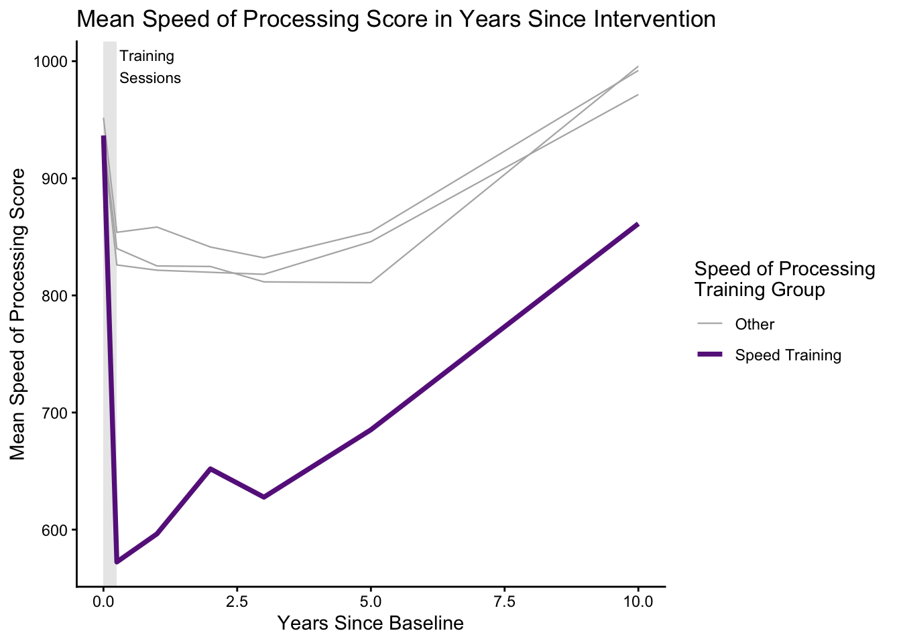

Longitudinal data project for Correlated Data at Macalester. [Download the full report (PDF)](active-speed-training-report.pdf).

## Question

In the ACTIVE trial, does cognitive training change older adults' speed of processing over 10 years, after adjusting for baseline age, gender, and baseline memory?

## Data and Model

ACTIVE randomized 2,489 adults aged 65+ to memory, reasoning, or speed-of-processing training, or a control group, with follow-ups after training and at years 1, 2, 3, 5, and 10. The outcome is total time across four speed tests (lower = faster).

We fit four linear mixed-effects models with `lme4::lmer()`, all with categorical time and adjustment for baseline age, gender, and baseline memory. They varied the treatment specification (all three training arms vs. speed training only) and the random effects (intercepts vs. intercepts and slopes). Likelihood ratio tests and BIC selected the simplest model: speed training × visit, with random intercepts by participant.

$$\text{Speed}_{it} = \beta_0 + \mathbf{X}_i'\boldsymbol\beta + \tau_t + \gamma_t\,\text{SpeedTrain}_i + b_i + \varepsilon_{it}, \qquad b_i \sim N(0, \sigma_b^2)$$

> **Fig. 1:** Mean speed-of-processing score by training group. Speed training (purple) produces a large immediate gain that fades but persists.

## Results

- Memory and reasoning training did not change speed differently from control.
- Speed training lowered scores by about **268 points** relative to all other groups immediately after training, and by **155 points** (SE 13.7) at year 10.
- By year 10, the other groups were **168 points slower** (SE 7.1) than at baseline; the speed group was close to its starting level.

Because assignment was randomized, these differences can be read as causal effects of the training. About 41% of participants died during follow-up, so estimates may reflect healthier survivors.

``` {.r filename="Selected model"}
lmer_mod3 <- lmer(Speed ~ AgeAtBaseline + GENDER + BaselineMem +
                    factor(Years) * SpeedGRP + (1 | AID),
                  data = modData, REML = FALSE)
```
