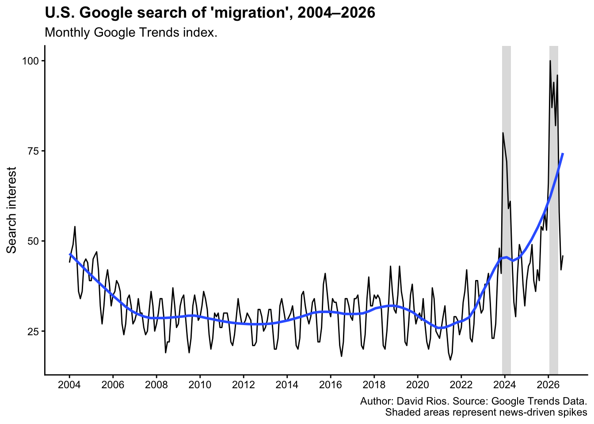
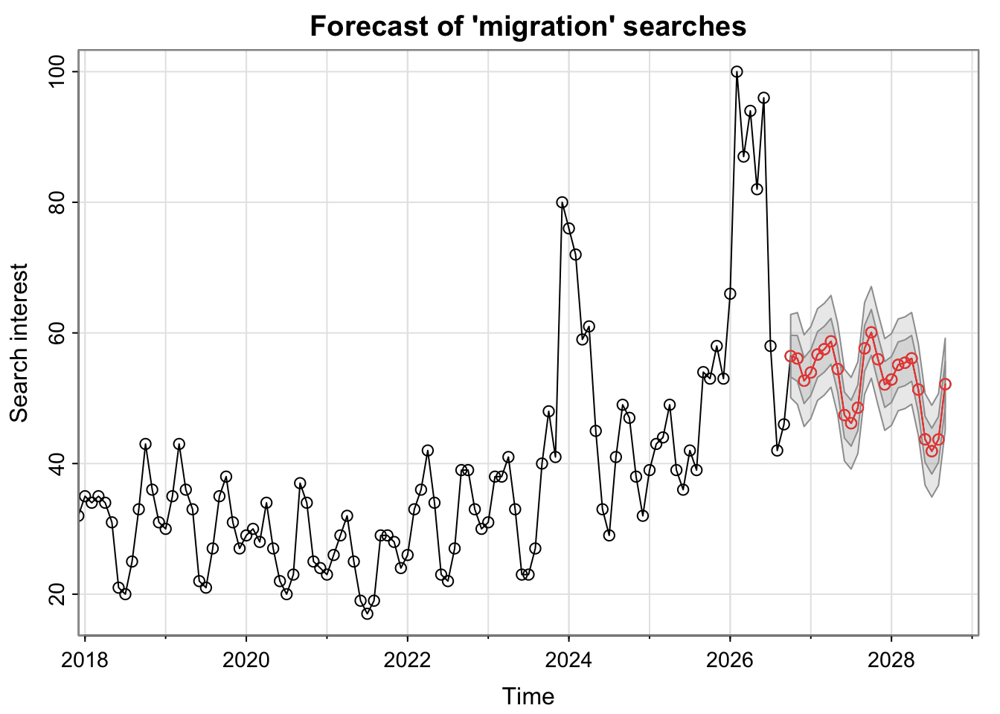

Time series project for Correlated Data at Macalester. [Read the full report](migration-trends-report.html).

## Question

How has U.S. public attention to migration evolved since 2004, and how much of it is driven by political events rather than trend or seasonality?

## Data and Model

Monthly Google Trends index (0–100) for the search term "migration" in the U.S., January 2004–September 2026 (273 months).

- **Trend:** B-spline with knots at 2015, 2020, and 2023.
- **Seasonality:** month indicators, plus indicators for two news-driven periods: Dec 2023–Apr 2024 (2024 presidential campaign) and Feb–Jun 2026 (Metro Surge enforcement coverage).
- **Errors:** MA(1), chosen by BIC and residual diagnostics after inspecting the ACF/PACF; fit with `astsa::sarima()`.

$$Y_t = f(t) + \sum_{m=2}^{12}\gamma_m \mathbb{1}[\text{month}_t = m] + \delta_1 N^{(24)}_t + \delta_2 N^{(26)}_t + \epsilon_t, \qquad \epsilon_t = W_t + \theta W_{t-1}$$

> **Fig. 1:** Monthly search interest with a loess smoother. Shaded areas mark the two news-driven periods.

## Results

- Search interest was flat from 2006 to about 2020, then rose sharply after 2023.
- Holding trend and month constant, interest was **30.7 points higher** (SE 1.8) in late 2023–early 2024 and **39.2 points higher** (SE 2.1) in early 2026; both p \< 0.01.
- $\hat\theta = 0.46$ (SE 0.06): each month's shock carries partly into the next month and no further.
- Seasonality peaks in spring and fall and dips in summer.

> **Fig. 2:** Two-year forecast (red) with prediction intervals, assuming no new news-driven spikes.

## Takeaways

Public attention to migration responds sharply to political events, beyond its long-run trend. Limitations: Google Trends is a relative, sampled index; "migration" also captures unrelated searches (bird or data migration); and the forecast extrapolates the spline.

``` {.r filename="Core model"}
X <- model.matrix(~ bs(Date, knots = c(2015, 2020, 2023)) +
                    factor(Month, levels = 1:12) + news24 + news26,
                  data = migration)[, -1]

m_ma1 <- sarima(migration_ts, p = 0, d = 0, q = 1, xreg = X)
```
