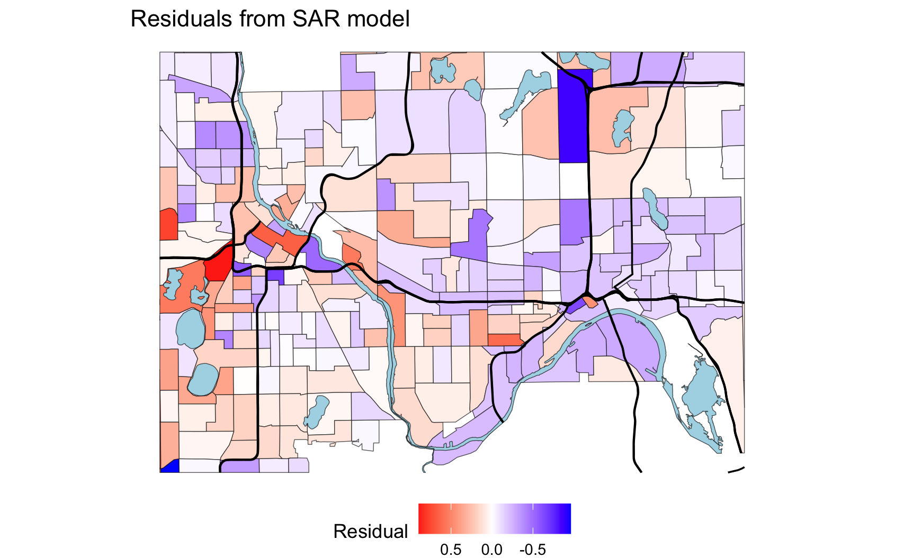

Spatial data project for Correlated Data at Macalester. [Download the slides (PDF)](Redlining_Presentation.pdf).

## Question

Between 1935 and 1940, the Home Owners' Loan Corporation (HOLC) graded neighborhoods from A ("best") to D ("hazardous"), and lenders denied credit to D-graded, largely minority neighborhoods. Do those grades still predict home values in the Twin Cities?

## Data and Model

- **Outcome:** log median home value by census tract, from American Community Survey 5-year estimates.
- **Treatment:** HOLC grade from [Mapping Inequality](https://dsl.richmond.edu/panorama/redlining), assigned to each tract by largest area of overlap. The sample is limited to the HOLC-graded area: most of Minneapolis, St. Paul, and some suburbs.
- **Neighborhood structure:** 3-nearest neighbors, which gives every tract a comparable number of neighbors and limits links across the Mississippi River.

We fit conditional (CAR) and simultaneous (SAR) autoregressive models and selected SAR: its residuals show essentially no spatial autocorrelation (Moran's I = −0.06, vs. 0.386 for CAR), and its BIC is lower (72.3 vs. 153.9).

$$\log(Y) = X\beta + \epsilon, \qquad \epsilon = \lambda W \epsilon + u, \qquad u \sim N(0, \sigma^2 I)$$

## Results

Relative to A-graded tracts, tracts graded C or D in the 1930s have home values roughly **23–24% lower** today.

| HOLC grade (ref. A) | Estimate | Std. error | p-value | Implied difference |
|:--------------------|---------:|-----------:|--------:|-------------------:|
| B                   |   −0.147 |      0.066 |   0.026 |             −13.7% |
| C                   |   −0.273 |      0.074 | \<0.001 |             −23.9% |
| D                   |   −0.261 |      0.078 | \<0.001 |             −23.0% |
| No grade            |   −0.131 |      0.071 |   0.063 |             −12.3% |

: SAR coefficient estimates. Implied difference = exp(β) − 1. BIC = 72.3.

> **Fig. 1:** Residuals from the SAR model, with interstates in black. The largest errors sit along highways: Lowry Hill (near downtown Minneapolis) is under-predicted and Little Canada is over-predicted, both bounded by interstates.

## Takeaways

Areas deemed "safe" for lending in the 1930s have higher home values today. The residual pattern suggests that mid-century interstate construction created additional divisions within the cities. The model includes no confounders, so these estimates are conditional associations, not causal effects.

``` {.r filename="Neighborhoods and SAR model"}
centroids <- st_centroid(st_geometry(joined), of_largest_polygon = TRUE)
knn_nb <- knn2nb(knearneigh(centroids, k = 3))
Ww <- nb2listw(knn_nb, style = "W")

mod_sar <- spautolm(log_val ~ grade, data = joined, listw = Ww, family = "SAR")
```
